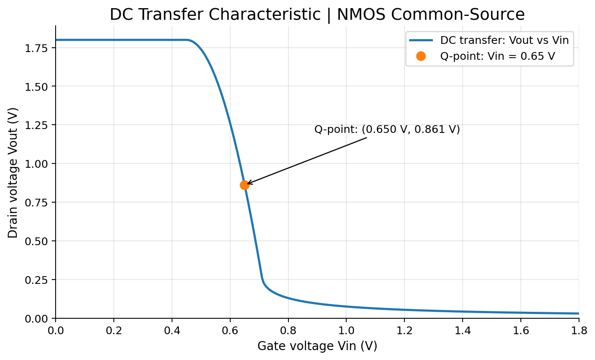
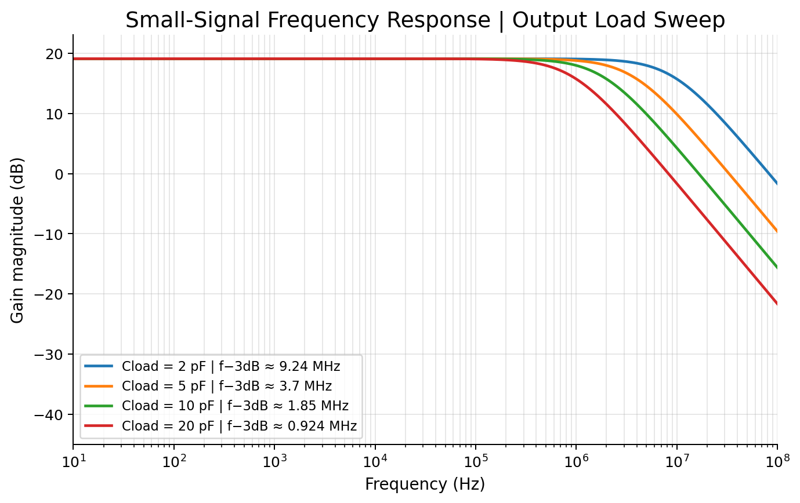
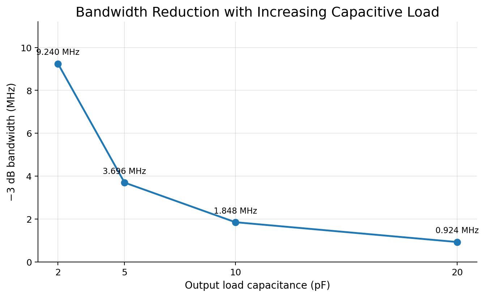
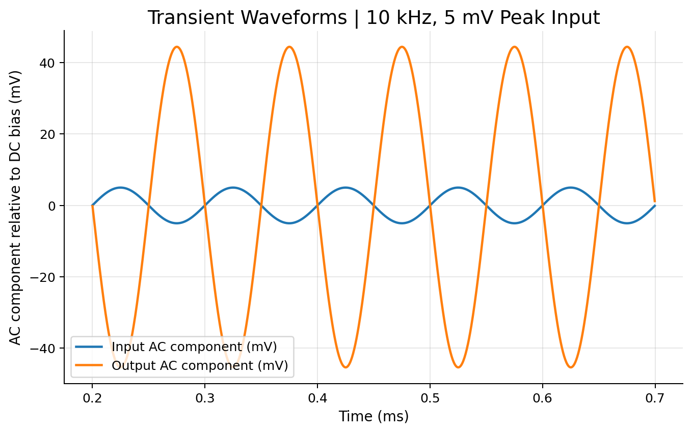
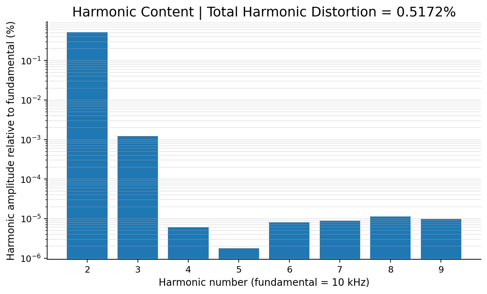

# NMOS Common-Source Amplifier | LTspice Design & Characterization

**Transistor-level amplifier study — DC biasing, voltage gain, AC response, capacitive loading, transient behavior and harmonic distortion.**



This repository documents a resistor-loaded NMOS common-source amplifier studied using **LTspice 26.0.2 (macOS)**. The objective was to validate transistor operation, compare hand calculations with simulation, and examine how loading and nonlinearity affect small-signal performance.

> **Scope:** A learning-focused design using a generic **Level-1 MOSFET model**, not a foundry PDK, fabricated integrated circuit, or measured semiconductor product. Results are tied to the stated model and conditions.

## Design at a glance

| Parameter | Configuration |
|---|---:|
| Supply voltage | **1.8 V** |
| Gate DC bias | **0.65 V** |
| Drain resistance | **9 kΩ** |
| MOSFET geometry | **W = 25 µm, L = 1 µm** |
| NMOS model | `LEVEL=1`, `VTO=0.45`, `KP=200u`, `LAMBDA=0.05` |
| Output capacitive loads | **2, 5, 10 and 20 pF** |
| Transient/Fourier input | **5 mV peak at 10 kHz** |

## Verified results

| Characteristic | Result | Verification |
|---|---:|---|
| DC output operating point, `Vout,Q` | **0.8612 V** | `.meas DC vout_q` |
| Estimated drain current, `ID` | **104.31 µA** | From `RD` voltage drop |
| DC transfer slope around bias | **-8.9829 V/V** | Two-point `.dc` measurement, inverting |
| AC gain at 100 Hz | **19.07 dB** | `.meas AC A0`, about 8.98 V/V magnitude |
| 10 kHz transient gain magnitude | **8.9831 V/V** | Peak-to-peak ratio |
| Total harmonic distortion | **0.5172%** | LTspice Fourier analysis, 5 mV peak input |

**Operating region check:** `VGS - VTO = 0.20 V`; `VDS ≈ 0.861 V`. As `VDS > VOV` and `VGS > VTO`, the NMOS operates in **saturation at the chosen bias point** according to the model.

**Approximate analytical gain:** `Av ≈ -gm × (RD || ro) ≈ -8.98 V/V`. See [engineering analysis](notes/analysis.md) for the full derivation, assumptions and caveats.

## 1 — DC transfer and quiescent bias

A DC sweep from 0 to 1.8 V establishes the switching/transfer behavior. The local slope near the selected operating point provides the **negative** common-source voltage gain.


**Open simulation:** [`circuits/01_DC_Transfer.asc`](circuits/01_DC_Transfer.asc)

## 2 — AC response and output capacitance

An AC 1 V small-signal source was used for direct transfer-function extraction. The load capacitance was swept over four values.



| Capacitive load | Measured −3 dB bandwidth |
|---:|---:|
| 2 pF | 9.240 MHz |
| 5 pF | 3.696 MHz |
| 10 pF | 1.848 MHz |
| 20 pF | 0.924 MHz |



**Observation:** increasing load capacitance decreases the circuit bandwidth in this model, while low-frequency gain is essentially unchanged.

**Open simulation:** [`circuits/02_AC_Load_Sweep.asc`](circuits/02_AC_Load_Sweep.asc)

## 3 — Transient response

A 10 kHz, 5 mV peak sine input produces an inverted output waveform. For visibility, the plot shows AC components after subtracting their DC bias levels; axes are explicitly labelled in millivolts.



The measured peak-to-peak voltage gain magnitude is **8.9831 V/V**.

**Open simulation:** [`circuits/03_Transient.asc`](circuits/03_Transient.asc)

## 4 — Fourier distortion

Fourier analysis was performed on the 10 kHz output waveform. LTspice reports **0.5172% THD**, with the second harmonic the dominant distortion term for the simulated operating point.



**Open simulation:** [`circuits/04_Fourier_Distortion.asc`](circuits/04_Fourier_Distortion.asc)

## Project files

```text
circuits/                 LTspice source schematics (.asc)
figures/                  Plots made from actual LTspice waveforms/logs
results/measurements.csv  Compact, traceable measurement table
evidence/                 Extracted LTspice log measurements (paths omitted)
notes/analysis.md         Hand-analysis and design interpretation
notes/source-file-mapping.md  Original-file mapping and reproducibility notes
```

## Reproduce the results

1. Download the repository or clone it locally.
2. Open the appropriate file in `circuits/` using LTspice.
3. Run the embedded `.dc`, `.ac` or `.tran` command.
4. Compare the resulting plots and `.meas`/`.four` values with [`results/measurements.csv`](results/measurements.csv) and the original output excerpts in [`evidence/`](evidence/01_dc_transfer.txt).
5. Review the derivations and limitations in [`notes/analysis.md`](notes/analysis.md).

The four source schematics have been **curated from the original files** to match their actual analysis purpose. See [`notes/source-file-mapping.md`](notes/source-file-mapping.md) for the exact mapping and where the source filenames differed from the saved directives.

## Limitations and future work

The model is a simplified educational transistor model; it does not include a modern foundry PDK, complete parasitic effects, corners, mismatch characterization or silicon measurements. LTspice also issued a channel-length recommendation warning for this Level-1 model. Future extensions may include temperature sweeps, bias optimization, distortion-versus-input-amplitude, more realistic MOS models and differential-pair design.

---

**Tools:** LTspice • MOSFET small-signal analysis • DC/AC/transient/Fourier simulation
